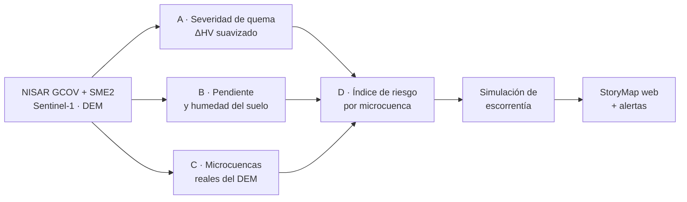

<div align="center">

# GeoSignal

### *¿Qué ocurre después de un incendio forestal?*

Web interactiva que transforma **radar satelital NISAR (Banda L)**, terreno y lluvia en información clara para **anticipar dónde bajará el barro** y prevenir desastres ambientales tras un incendio.


**Caso de estudio:** incendio de **Calvos de Randín** (Ourense, Galicia) · ignición `2026-09-24` · controlado `2026-09-27`

**Observar** → **Analizar** → **Prevenir**

</div>

---

## Índice

1. [La segunda emergencia](#la-segunda-emergencia)
2. [Nuestra propuesta](#nuestra-propuesta)
3. [Antes y después del incendio](#antes-y-después-del-incendio)
4. [Radar para humanos](#radar-para-humanos)
5. [Cómo funciona](#cómo-funciona)
6. [Resultados y honestidad científica](#resultados-y-honestidad-científica)
7. [La aplicación web](#la-aplicación-web)
8. [Simulador de lluvia y soluciones](#simulador-de-lluvia-y-soluciones)
9. [Alertas por correo](#alertas-por-correo)
10. [Estructura del repositorio](#estructura-del-repositorio)
11. [Pipeline de datos](#pipeline-de-datos)
12. [Escalabilidad y futuro](#escalabilidad-y-futuro)
13. [Fuentes de datos](#fuentes-de-datos)

---

## La segunda emergencia

Cuando se apaga un incendio, la emergencia **no ha terminado**. La vegetación que protegía el suelo ha desaparecido, y con ella las raíces que lo sujetaban. Cuando vuelven las lluvias, el agua arrastra tierra, ceniza, piedras y restos de árboles hacia zonas más bajas.

| | |
|---|---|
| **Las primeras lluvias** | El agua no penetra en la tierra quemada y se forman riadas de barro y ceniza. |
| **Los pueblos aguas abajo** | Toneladas de sedimento llegan a los ríos, dañan carreteras, puentes e infraestructuras y contaminan las captaciones de agua potable. |
| **La ceguera óptica** | Los satélites fotográficos no ven nada bajo nubes densas o columnas de humo, justo cuando más hace falta. |

> **Precedente real:** tras el megaincendio de la Ribeira Sacra (Pantón y Sober, Lugo, sept. 2025, 1.805 ha), las lluvias arrastraron ceniza hacia los ríos Cabe y Sil y obligaron a obras de emergencia.

---

## Nuestra propuesta

GeoSignal combina **radar satelital de microondas** (Banda L de NISAR) con **mapas de elevación del terreno**. En lugar de limitarse a marcar el perímetro del fuego, la plataforma **evalúa el estado físico del bosque** y **calcula en qué microcuencas hidrográficas bajará el barro**, identificando puntos estratégicos *antes* de que empiecen las lluvias.

```
 OBSERVAR                    ANALIZAR                      PREVENIR
 ───────────────             ───────────────────────       ─────────────────────────
 Antes / después             Pendiente, humedad,           Simulador de lluvia
 con radar NISAR      →      vegetación y microcuencas  →  y soluciones basadas
 (óptico vs radar)           reales                        en la naturaleza (fajinas)
```

La aplicación se divide en **cuatro partes**:

| # | Parte | Qué permite |
|:-:|---|---|
| 1 | **Antes y después** | Comparar el estado del terreno con un slider óptico vs. radar. |
| 2 | **Análisis del terreno** | Estudiar pendientes, vegetación y humedad: lo que influye en cómo se mueve el agua. |
| 3 | **Análisis de cuencas** | Identificar hacia dónde se dirige el agua y qué núcleos quedan aguas abajo. |
| 4 | **Simulador de lluvia y soluciones** | Probar escenarios de lluvia y ver cómo ciertas medidas reducen el riesgo. |

---

## Antes y después del incendio

La comparación permite entender cómo ha cambiado el territorio y qué zonas necesitan un análisis más detallado.

|  Antes del incendio — *¿cómo era el terreno?* |  Después del incendio — *¿qué ha cambiado?* |
|---|---|
| La vegetación y las zonas forestales | Zonas con cambios compatibles con pérdida de vegetación |
| La estructura del bosque | La superficie afectada |
| La forma y la altura del terreno | Áreas donde el suelo ha quedado más expuesto |
| La humedad del suelo disponible | Pendientes que favorecen erosión y arrastre de materiales |

---

## Radar para humanos

<details open>
<summary><b>¿Qué es un radar SAR? El «murciélago» espacial </b></summary>

Una cámara normal es **pasiva**: necesita la luz del Sol. Un radar de apertura sintética (SAR) es **activo**: emite sus propios pulsos de microondas hacia la Tierra y mide el eco que vuelve (*retrodispersión*). Por eso ve **de día, de noche y a través de nubes y humo**.
</details>

<details open>
<summary><b>La ventaja de la Banda L</b></summary>

NISAR usa una longitud de onda larga (**~24 cm**) que no rebota en las hojas pequeñas: atraviesa el follaje e interactúa con **ramas gruesas, troncos y suelo**. Es la estructura del bosque lo que «oye» el satélite.
</details>

<details open>
<summary><b>¿Cómo sabemos que el bosque se quemó? Polarización HV</b></summary>

- **Bosque sano:** las microondas rebotan en mil direcciones entre las ramas (como una bola de *pinball*) → eco **brillante** en `HV` (dispersión volumétrica).
- **Tras el fuego:** las copas desaparecen, el «pinball» 3D se desvanece y el eco **cae bruscamente** (`ΔHV`). GeoSignal mide esa caída de energía para localizar la destrucción real.

| `ΔHV = post − pre` | Significado |
|---|---|
| `0 dB` | Sin cambio |
| `−1,5 dB` | Caída de ~29 % de la energía (umbral estándar de quema en Banda L) |
| `−3,0 dB` | Caída del 50 % de la señal estructural |
| `−6,0 dB` | Caída del 75 % (calcinación extrema del dosel) |
</details>

<details>
<summary><b>Ruido <i>speckle</i> («sal y pimienta»)</b></summary>

Las imágenes radar tienen un ruido visual parecido al de los televisores antiguos. GeoSignal aplica un suavizado espacial de ~100 m (multilook) **antes** de umbralizar, lo que elimina falsos positivos: sin él, cuencas que nunca ardieron marcaban un 12–14 % de «quemado».
</details>

<details>
<summary><b>Las misiones: NISAR y Sentinel-1</b></summary>

- **NISAR (NASA-ISRO):** primer radar de doble frecuencia (Banda L ~24 cm + Banda S ~10 cm). Repite su órbita cada **12 días**, aunque la frecuencia real de escenas varía según la zona.
- **Sentinel-1 (Copernicus):** otro radar (Banda C) que complementa a NISAR y permite comparar cambios en el tiempo.

| Producto | Qué aporta |
|---|---|
| `GCOV` | Retrodispersión calibrada (`HH`, `HV`): estructura de la vegetación y cambios pre/post incendio. |
| `SME2` | Humedad superficial del suelo (200 m): dato complementario sobre las condiciones del terreno. |
</details>

---

## Cómo funciona

El análisis se realiza en **cuatro pasos**:



### A · Localizar las zonas afectadas
Se descargan las escenas NISAR (antes y después) y se compara la señal `HV` con suavizado espacial para delimitar dónde el bosque o el matorral perdieron estructura. **Resultado:** un mapa de zonas afectadas y comparativa pre/post.

### B · Analizar el terreno
No todas las zonas quemadas tienen el mismo riesgo. Se estudian **pendiente**, **altitud**, **pérdida de vegetación**, **humedad del suelo** y **tipo de terreno** a partir de satélite y modelos digitales de elevación.

### C · Dividir el terreno en cuencas
Una **cuenca hidrográfica** es la zona donde el agua de lluvia acaba dirigiéndose a un mismo río, arroyo o punto de salida: como un **embudo**. Si se quema una montaña, la lluvia baja por sus laderas, arrastra tierra y ceniza hasta un arroyo, de ahí a un río y, finalmente, a un pueblo situado más abajo. Por eso no basta con saber dónde se quemó: hay que saber **hacia dónde se desplazará el agua**.

A partir del modelo digital de elevación se calcula hacia dónde fluye y dónde se acumula el agua, y se delimitan **26 microcuencas reales**. Esto permite saber de dónde procede el agua de cada cauce, qué zonas quemadas envían sedimento al mismo lugar y qué poblaciones quedan aguas abajo.

### D · Calcular el riesgo potencial

```
Riesgo = Severidad de quema × (Pendiente + Sequedad del suelo)
```

Multiplicar (y no sumar) evita falsas alarmas: **una montaña muy empinada que no se quemó no marca riesgo**; solo las zonas quemadas, empinadas y con suelo seco alcanzan la prioridad máxima.

| Factor | ¿Por qué importa? |
|---|---|
| Superficie quemada | Dónde se perdió la vegetación que protegía el suelo |
| Pendiente | Las laderas inclinadas aceleran agua y sedimentos |
| Humedad / sequedad del suelo | Condición del terreno antes de llover |
| Cuenca hidrográfica | Hacia dónde se dirige el agua |
| Lluvia | Cómo cambia el escenario según la intensidad |

| Nivel | Significado |
|---|---|
| 🟢 **Riesgo bajo** | Condiciones menos favorables para generar escorrentía y erosión. |
| 🟡 **Riesgo medio** | Se combinan algunos factores que pueden favorecer estos procesos. |
| 🔴 **Riesgo alto** | Coinciden varios factores desfavorables; requieren especial atención. |

En el caso de estudio, las cuencas 8 y 9, que contienen el incendio real, salen en el **puesto #1 y #2 de 26**, con más de 20× de margen sobre la tercera.

---

## Resultados y honestidad científica

> El jurado —y la ciencia— penalizan las afirmaciones exageradas. Mostramos **todas** las cifras, también las incómodas.

| Fuente | Superficie | Qué mide |
|---|---:|---|
| Perímetro oficial (Xunta de Galicia) | **~518 ha** | 370 ha arbolado + 148 ha pasto/matorral |
| Copernicus EFFIS (detección térmica NRT) | **1.234 ha** | Detección automática, sobrestima |
| Sentinel-2 `dNBR ≥ 0,27` (referencia óptica) | **483,12 ha** | Cicatriz óptica |
| NISAR, par único húmedo (`19-sep` vs `01-oct`) | **87,5 ha** | Sesgado por subida de humedad (`+1,16 dB` en control, `qa_pass: false`) |
| **NISAR, compuesto multitemporal lineal** | **324,88 ha** | 5 pasadas secas pre vs `13` + `25-oct`, multilook 5×5, calibración de control a `−1,5 dB` · `FP = 0,16 %` · precisión `0,993` · **`F1 = 0,799`** vs `dNBR` |

### ¿Qué ve y qué *no* ve la Banda L?

Cruzando `ΔHV` con **ESA WorldCover 2021**:

- **Matorral y pasto abierto** (en Galicia, monte bajo/tojo): detección muy precisa — **247,5 ha**.
- **Fuego de superficie bajo copa intacta:** apenas atenúa el volumen superior — solo **63,6 ha** detectadas de **576,3 ha**; `ΔHV ≈ −0,07 dB` en las **98,84 ha** omitidas con `dNBR ≥ 0,27`.

**Por tanto:** GeoSignal **no** afirma que NISAR aísle «quema severa en masa arbolada» ni que mida la hidrofobicidad del suelo (el radar no detecta química). Lo que sí hace es combinar **pérdida de copa (`ΔHV`) + sequedad (`SME2`) + pendiente (`DEM`)** en un **índice físico de susceptibilidad de escorrentía y arrastre**.

### Qué es real y qué no
Área quemada, microcuencas, ranking y distancias salen del pipeline. La lluvia es pronóstico de modelo; el volumen de escorrentía usa un coeficiente `C = 0,6` y los umbrales de alerta **no están calibrados sobre el terreno**: deben ajustarse con Protección Civil / AEMET antes de cualquier uso operativo.

---

## La aplicación web

El punto de entrada (`web/index.html`) es un **StoryMap de 11 capítulos** con:

-  Serie temporal completa de NISAR desde junio de 2026
-  Comparativa **óptico (cegado por el humo) vs. radar (nítido)**
-  Sensibilidad multinivel en dB (`−1,5` / `−3,0` / `−6,0`)
-  Cruce con coberturas ESA WorldCover
-  Riesgo hidrogeomorfológico por microcuenca y núcleos aguas abajo (**As Meaus, Calvos, Guntumil**…)
-  Simulación dinámica de escorrentía
-  Capítulo 11: alertas por correo

```bash
# Solo la web (estática)
cd web && python -m http.server 8000      # → http://localhost:8000/

# Web + capítulo de alertas activo (desde la raíz del repo)
python3 -m alerts serve                   # → http://127.0.0.1:8765/
```

El explorador técnico original sigue en `web/real_demo.html`. Para regenerar los insumos ligeros (`web/assets/data/`) desde las escenas `.h5` locales:

```bash
python data/extract_aoi_stack.py
python data/build_story_data.py
python data/validate_story_data.py
```

>  **Filosofía:** nada de procesar gigabytes en vivo. El preprocesamiento científico es reproducible en local (Python) y genera capas ligeras (`.geojson`, `.png`) servidas por una web estática, rápida e interactiva.

---

## Simulador de lluvia y soluciones

### «¿Qué pasaría si llueve?»
Un control deslizante cambia la intensidad de la lluvia y la app muestra cómo cambia el escenario:

| 10 mm/h | 30 mm/h | 50 mm/h | 80 mm/h |
|:-:|:-:|:-:|:-:|

Al aumentar la intensidad se visualiza **por dónde se desplaza el agua**, **qué zonas acumulan más escorrentía**, **qué cauces reciben las laderas quemadas** y **qué poblaciones e infraestructuras quedan aguas abajo**.

### Soluciones basadas en la naturaleza
Las **fajinas** son barreras de troncos y restos vegetales que se colocan sobre el terreno para frenar el agua y retener sedimento. La app compara dos escenarios:

- **Sin soluciones:** cómo podría desplazarse el agua por el terreno quemado.
- **Con soluciones:** barreras en zonas seleccionadas y cómo cambian el recorrido del agua y la acumulación de sedimento.

---

## Alertas por correo

Módulo `alerts/` (solo biblioteca estándar de Python). Envía dos tipos de correo, escritos para vecinos y sin tecnicismos:

- **Informe del estudio** — al suscribirse: cuánto se quemó según cada fuente, por qué radar, por dónde puede bajar el agua, qué pasa con 20 / 40 / 80 l/m² y qué significa para su pueblo.
- **Aviso de lluvia** — solo cuando la previsión real (Open-Meteo, 3 días) alcanza el nivel elegido: amarillo / naranja / rojo con 20 / 40 / 80 mm en 24 h o 10 / 20 / 40 mm/h.

```bash
python3 -m alerts places                      # núcleos y su exposición
python3 -m alerts subscribe ana@ejemplo.org --name Ana --place "As Meaus"
python3 -m alerts subscribe pc@ejemplo.org --profile technical --min-level 2
python3 -m alerts check                       # nivel con el pronóstico real
python3 -m alerts report                      # informe en seco → alerts/outbox/*.html
python3 -m alerts run                         # informes pendientes + avisos, en seco
python3 -m alerts run --send                  # envía de verdad (lo que ejecuta cron)
python3 -m alerts run --rain-mm 60            # vista previa con 60 mm (nunca se envía)
python3 -m alerts unsubscribe ana@ejemplo.org
```

<details>
<summary><b>Configuración SMTP, cron y notas de seguridad</b></summary>

**Gmail (por defecto).** Copia `.env.example` a `.env` (ya en `.gitignore`):

```bash
ALERTS_SMTP_USER=cuenta-que-envia@gmail.com
ALERTS_SMTP_PASSWORD=xxxx xxxx xxxx xxxx   # contraseña de aplicación, no la normal
```

Se crea en `https://myaccount.google.com/apppasswords` (requiere verificación en dos pasos). Gmail limita a ~500 destinatarios/día. Para otro proveedor define `ALERTS_SMTP_HOST` / `ALERTS_SMTP_PORT` / `ALERTS_SMTP_SECURITY`.

**Cron cada 3 horas:**

```
0 */3 * * * cd /ruta/a/GeoSignal && python3 -m alerts run --send >> alerts/cron.log 2>&1
```

`alerts/state.json` evita repetir correos; si el nivel sube para el mismo día, sí vuelve a avisar.

**Antes de publicar fuera de localhost:** la suscripción no pide confirmación por correo y no hay límite de peticiones. `subscribers.json`, `state.json` y `outbox/` no se commitean (datos personales). Pruebas:

```bash
python3 -m unittest discover -s alerts/tests -t .
```
</details>

---

## Estructura del repositorio

```
data/
  config.py              AOI, fechas pre/post-fuego, umbral de quemado
  search_download.py     busca y descarga GCOV + SME2 + Sentinel-1 en ASF
  compute_change.py      diff de HV (dB) pre/post, suavizado → burn_severity.tif
  convert_sme2.py        SME2 (EASE-Grid, 200 m) → GeoTIFF alineado
  compute_slope.py       Copernicus DEM GLO-30 → slope.tif alineado
  delineate_basins.py    DEM → microcuencas (WhiteboxTools) → basins.geojson
  risk_index.py          quema × (pendiente + sequedad) → riesgo por cuenca
  extract_aoi_stack.py   pila multitemporal recortada al AOI
  build_story_data.py    capas ligeras para el StoryMap
  validate_story_data.py comprobaciones de los datos de la web
web/
  index.html             StoryMap de 11 capítulos (entrada principal)
  real_demo.html         explorador técnico original
  demo.html              maqueta sin datos reales
  assets/ story/ vendor/ recursos, capítulos y librerías
alerts/
  __main__.py            CLI: check / run / serve / subscribe / unsubscribe / list / places
  server.py · forecast.py · engine.py · geodata.py
  report.py · compose.py · mailer.py
```

---

## Pipeline de datos

> **Ejecuta todo desde la raíz del repo**, no desde `data/` (las rutas `data/raw`, `data/out`, `web/data/...` son relativas a la raíz).

<details>
<summary><b>Pasos detallados (equipo de datos)</b></summary>

1. **Entorno:** `python3 -m venv data/.venv && data/.venv/bin/pip install -r data/requirements.txt`
2. **Credenciales Earthdata** (solo para descargar): cuenta gratuita en `urs.earthdata.nasa.gov`, aprobar la app de ASF (`https://urs.earthdata.nasa.gov/approve_app?client_id=BO_n7nTIlMljdvU6kRRB3g`, o la descarga falla con 403 *EULA Acceptance Failure*) y exportar `EARTHDATA_TOKEN` (o `EARTHDATA_USERNAME`/`EARTHDATA_PASSWORD`, o `~/.netrc`). **Nunca** en un archivo del repo.
3. **Buscar y descargar:** `data/.venv/bin/python3 data/search_download.py` — empareja track/frame en pre y post y lista Sentinel-1 GRD (no lo descarga entero: ~1 GB por escena).
4. **Severidad:** `python3 data/compute_change.py data/raw/<pre.h5> data/raw/<post.h5>` → `data/out/burn_severity.tif` (banda 1: ΔHV en dB; banda 2: máscara de quemado). Para estadísticas, recortar con el perímetro EFFIS (`rasterio.mask.mask`), **nunca con `AOI_BBOX`** (sobrestima ~4,5×).
5. **Humedad:** `python3 data/convert_sme2.py <sme2_post.h5> data/out/burn_severity.tif data/raw/soil_moisture.tif` (EPSG:6933 → rejilla de severidad).
6. **Pendiente:** `python3 data/compute_slope.py <dem.tif> data/out/burn_severity.tif data/raw/slope.tif` (tile Copernicus GLO-30, público en AWS, sin login).
7. **Microcuencas:** `python3 data/delineate_basins.py <dem_sin_predictor>.tif data/raw/hydro data/raw/basins.geojson` — 26 cuencas reales; umbral de 10.000 celdas. El GeoTIFF de Copernicus usa un predictor que WhiteboxTools no lee: reescribirlo con rasterio (`compress='lzw', predictor=1`); `set_working_dir()` necesita ruta absoluta.
8. **Activos aguas abajo:** aportar `data/raw/assets.geojson` (OSM: Randín, Calvos de Randín, As Meaus/Baltar, Baltar).
9. **Riesgo:** `python3 data/risk_index.py` → `web/data/basins_risk.geojson`.
10. **PNG para el slider:** `gdal_translate -of PNG -scale data/out/burn_severity.tif web/data/severity.png`.
</details>

<details>
<summary><b>Escenas NISAR verificadas contra ASF (2026-11-14)</b></summary>

| Producto | Track/Frame | Antes | Después |
|---|---|---|---|
| NISAR GCOV | **15/23 (asc.) — el usado** | 2026-09-19 | 2026-10-01 |
| NISAR GCOV | 124/68 (desc.) — descartado | 2026-09-14 | 2026-10-08 |
| NISAR GCOV | 52/67 (desc.) | 2026-09-09 | 2026-10-15 |
| NISAR GCOV | 124/67 (desc.) | 2026-09-14 | 2026-10-20 |
| NISAR SME2 | mismos track/frame |  sep–oct |  sep–oct |
| Sentinel-1 GRD | paths 147 (asc.) / 52 (desc.) | 48 escenas ago–nov, cada ~6 días | — |

El track 124/68 solo cubre ~35 % del perímetro real; el 15/23 cubre el **99,9 %**.
</details>

<details>
<summary><b>Validación mínima antes de construir sobre esto</b></summary>

- Comprueba siempre `valid_px / expected_px` dentro del perímetro antes de confiar en un porcentaje de quemado.
- Una imagen «post» en día de lluvia sube la retrodispersión del suelo y enmascara la caída de `HV`; prefiere ventanas secas o el cociente `HV/HH`.
- Verifica la alineación de proyecciones (`EPSG`) y rejillas antes de operar entre rásteres.
- Los archivos pesados (`.h5`, `.tif`) no se versionan.
</details>

---

## Escalabilidad y futuro

- **Replicable hoy:** el 27 de octubre de 2026 el Gobierno de España declaró **Calvos de Randín (Ourense)** y **Quiroga (Lugo, Ribeira Sacra)** *Zonas Afectadas Gravemente por una Emergencia de Protección Civil*. El pipeline es aplicable a ambos.
- **Sinergia espacial ibérica:** NISAR (radiografía estructural cada 12 días) + **Constelación Atlántica** (PERTE Aeroespacial España-Portugal: 16 microsatélites con revisita de ~3 h, reflectometría GNSS-R en Banda L para humedad rápida) + sensores IoT pluviométricos en las microcuencas.
- **Multifrecuencia:** SAOCOM (CONAE, Banda L) para series históricas y RADARSAT Constellation (CSA, Banda C) para contraste.
- **Otras aplicaciones de NISAR:** subsidencia e inundaciones (`GUNW`), glaciares, agricultura y gestión hídrica.

---

## Fuentes de datos

| Fuente | Uso |
|---|---|
| **NISAR** (NASA-ISRO) vía ASF | `GCOV` (retrodispersión HH/HV), `SME2` (humedad del suelo) |
| **Sentinel-1** (Copernicus) | Complemento SAR |
| **Sentinel-2 / HLS** | Referencia óptica (`dNBR`) y comparativa con humo |
| **Copernicus DEM GLO-30** | Pendiente y microcuencas |
| **Copernicus EFFIS** | Perímetro NRT del incendio (`nrt.ba.poly`) |
| **ESA WorldCover 2021** | Tipo de cobertura quemada |
| **Open-Meteo** | Pronóstico de lluvia para las alertas |
| **OpenStreetMap** | Núcleos y embalses aguas abajo |

---

<div align="center">

**GeoSignal** · NASA Space Apps Challenge — *Dancing with the SARs*

*Porque el riesgo no termina cuando se apagan las llamas.*

</div>
